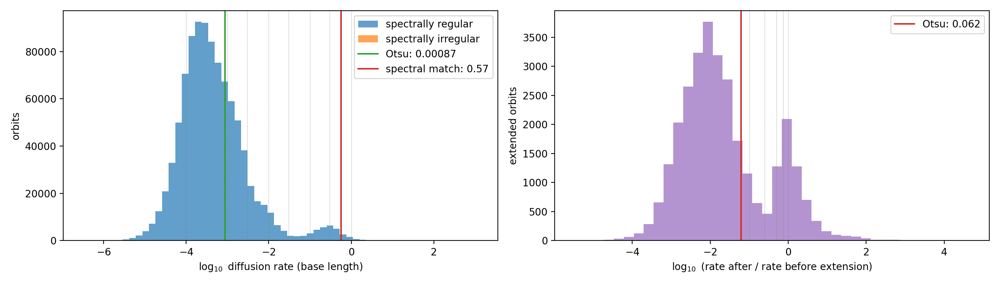

Choosing parameters and checking convergence
=============================================

Three settings decide how trustworthy a classification is: the potential orders
``n_max``/``l_max``, the integration length, and the chaos threshold
``diffusion_threshold``. Each has a helper.

Choosing n_max / l_max
----------------------

``scripts/sweep_truncation.py`` sweeps a grid of ``(n_max, l_max)``, building and
validating the potential at each point (one MPI rank per combination), then
recommends the cheapest orders at the convergence knee. Feed the result to
``run_orbits_mpi.py``:

.. code-block:: bash

   srun --mpi=pmix -n 16 python scripts/sweep_truncation.py --file snap.hdf5
   # -> Recommended: n_max=8 l_max=4   ->  run_orbits_mpi.py --n-max 8 --l-max 4

It prints the full error grid and can save a heatmap with ``--plot sweep.png``.
The recommendation is convergence-relative (cheapest orders within ``--slack`` of
the best grid error), *not* an absolute median-error cut: the median potential
error is monopole-dominated, so an absolute cut would wrongly accept
``l_max = 0``.

From Python, ``Potential.truncation_convergence`` gives the same information as
a ``TruncationSweep`` with a ``.plot()`` method.

For a ``MultiComponentPotential``, each species is fit independently (see
:doc:`potentials`), so tune orders per species: build that species' own subset
(``ps.select(ps.species_mask("DM"))``) and sweep/validate it exactly as above
before fixing the order used in ``scf_component``/``disc_component``.

Extending drifting orbits (adaptive extension)
----------------------------------------------

A short integration cannot always tell chaos from a slowly converging regular
orbit: both show some frequency drift between the two halves of the run. The
distinction is how the drift behaves as the window grows. A regular orbit's
measured drift is a resolution effect and falls steeply (roughly as the length
ratio to the power -2), whereas a chaotic orbit's does not.

With ``max_extensions > 0``, ``analyse_family`` re-integrates only the orbits
whose diffusion rate exceeds ``diffusion_threshold``, for ``extension_factor``
times longer. An orbit whose rate has not fallen below ``diffusion_drop`` times
its previous value is judged chaotic and is not extended again; one that is still
above the threshold but falling is extended further, up to ``max_extensions``
times. Orbits below the threshold are never re-integrated, so the extra cost is
confined to the drifting orbits:

.. code-block:: python

   res = lf.analyse_family(pot, ps, n_periods=50,
                           max_extensions=2, extension_factor=2.0,
                           diffusion_threshold=0.1, diffusion_drop=0.5)
   res.n_periods_used       # (N,) periods each orbit was integrated for (50/100/200)
   res.diffusion_previous   # (N,) rate before the last extension (NaN if never extended)

   # Use the same values when classifying: an extended orbit is labelled irregular
   # only if its rate is above the threshold AND did not fall by the drop factor.
   cls = res.classify(diffusion_threshold=0.1, diffusion_drop=0.5)

Orbits never extended (all orbits when ``max_extensions=0``) are labelled by the
plain threshold cut. An orbit that is still above the threshold but falling when
the extensions run out keeps its regular label, and a warning reports how many
there are; raise ``max_extensions`` to settle them. Off by default. The run
script exposes it as ``--max-extensions``, ``--extension-factor``,
``--diffusion-threshold`` and ``--diffusion-drop``.

Choosing resonance_tol
----------------------

A box orbit is a boxlet when its fundamental frequencies satisfy a low-order
commensurability ``|n . w| / max|w| < resonance_tol``. Non-resonant boxes also
pass this test by chance, more often the looser the tolerance and the higher
the order. ``scripts/boxlet_null_test.py`` measures this on your own results: it
shuffles each axis's frequencies independently between the box orbits (which
keeps the frequency distributions but destroys every real resonance) and
compares the hit rates of the real and shuffled frequencies per order and per
resonance vector:

.. code-block:: bash

   python scripts/boxlet_null_test.py orbits.npz --tol 1e-2 1e-3 5e-4

On the test models, ``1e-2`` (the former default) passed ~30% of the shuffled
triples at orders <= 5, so most of its "boxlets" were coincidences; at the
default ``1e-3`` ~3% pass, and 60--97% of the boxlets found at orders 2--5 are
genuine. Orders 6 and 7 are dominated by chance hits, so the generic search
stops at ``resonance_max_order = 5``, and the named pretzel (3:4, order 7) is
searched for explicitly; its purity depends on the population (96% in a
triaxial test model, ~50% in a bar-like one). Genuinely trapped orbits sit far
inside the tolerance (residuals 1e-4 down to 1e-8), so tightening it further
mainly removes chance hits.

Choosing diffusion_threshold and diffusion_drop
-----------------------------------------------

``classify()`` labels orbits whose frequency-diffusion rate exceeds
``diffusion_threshold`` (default 0.1) as irregular; with extension the same
threshold decides which orbits are re-integrated, and ``diffusion_drop`` (default
0.5) decides whether an extended orbit's drift has fallen enough to be regular.
The right values depend on the integration length and population, so run the
helper on a saved result:

.. code-block:: bash

   python scripts/choose_diffusion_threshold.py orbits.npz --plot threshold.png

It prints the ``log10(rate)`` distribution at the base integration length, and a
table of how many orbits (and how much of each regular family, tubes especially)
each candidate threshold would flag; with extension this is the fraction that
would be re-integrated. It suggests a threshold two ways: the Otsu split of the
log-rate histogram, and the threshold that best agrees with the independent
spectral irregular test (F1). For results with extended orbits it also tabulates
candidate drop factors from the ratio of each orbit's rate after to before
extension, which is usually more clearly bimodal than the raw rate. It warns when
a distribution is not bimodal, in which case no value separates two populations
cleanly and a conservative one is safer.

Example: reading the figure
^^^^^^^^^^^^^^^^^^^^^^^^^^^

``--plot`` saves a figure like the one below, from a run with extension on a
large population (several hundred thousand orbits).

*Left: diffusion rate at the base integration length. Right: the rate after
extension divided by the rate before it, for the extended orbits. Dotted lines
mark the candidate values tabulated by the script; solid lines mark its
suggestions.*

**Left panel (choosing** ``diffusion_threshold`` **).** Almost all orbits sit in
one large peak at ``log10(rate)`` of about -3.7, a rate of order ``2e-4``: these
are the regular orbits, whose drift is only the resolution limit of a finite
window. A second, much smaller bump appears at about -0.5 (a rate of ~0.3),
well separated from the main peak by a shallow valley near -1.5 to -1 (rates of
0.03 to 0.1). The bump is the population that really drifts, so the threshold
belongs in the valley, not inside either peak. Here that is roughly 0.03 to 0.1.
The default of 0.1 sits on the lower flank of the bump and so leaves out its
weakest members; 0.03 catches more of the bump at the cost of a few regular
orbits from the main peak's tail (the per-family table shows how many).

Neither suggestion line is in the valley, and the script's note that they
differ by more than a decade applies:

* The **Otsu** line (green, 0.00087) is inside the main regular peak. With one
  dominant population and a small one, Otsu splits the large peak instead of
  finding the valley between the two, so it is not a usable answer here.
* The **spectral match** line (red, 0.57) lies to the right of the bump. The
  spectrally irregular population is too small to be visible at this scale
  (the orange bars cannot be seen), so the F1 score is driven by very few orbits
  and this value is not reliable either.

When the two suggestions disagree like this, trust the histogram and the
per-family table over the suggestions.

**Right panel (choosing** ``diffusion_drop`` **).** This shows how much each
extended orbit's drift changed when it was re-integrated for longer. It is
clearly bimodal, which is what makes extension useful:

* The large peak at about -2 (the rate fell by a factor of ~100) is orbits whose
  drift was a short-window effect. They settled as the window grew, which is
  what a regular orbit does, so they keep their regular label.
* The smaller peak at about 0 (a ratio of 1) is orbits whose drift did not
  change at all with the longer window. Drift that does not shrink with the
  window is the signature of chaos, so these are labelled irregular.

The valley between the two is at about -0.6 to -0.5 (a ratio of ~0.25 to 0.3),
so any ``diffusion_drop`` in the range 0.25 to 0.5 separates them well; the
default of 0.5 is safe. The red **Otsu** line (0.062) again falls on the
shoulder of the large peak, inside the regular population, so it would call some
falling orbits chaotic and should not be used. The drop factor is well
determined here: the two peaks are far apart and the valley between them is
shallow in comparison.

The caveats on this example: the figure alone does not show the integration
length or the extension factor, which set how far a regular orbit's rate falls
(roughly the length ratio to the power -2), so the position of the large peak on
the right depends on them. Read the peaks and valley off your own histograms, not
the numbers here.

How much chaos the flags catch
~~~~~~~~~~~~~~~~~~~~~~~~~~~~~~

The tumbling perfect ellipsoids (below) come with AGAMA Lyapunov exponents from
200-period integrations in the exact potential: 12%, 24% and 42% of their orbits
are chaotic at corotation radii of 16, 8 and 4 half-mass radii, and 0.1% in the
static model. With the defaults lanfear flags (irregular or diffusing) 24%, 35%
and 41% of those chaotic orbits, and 1.3%, 1.3% and 4.8% of the regular ones
(1.7% static, where every orbit is regular). **The irregular fraction is
therefore a lower bound on the chaotic fraction, by a factor of about 2--4.**

- For 31--43% of the chaotic orbits chaos only sets in after 50 periods, so no
  indicator measured in a 50-period window can see it; even among those chaotic
  within 50 periods only 27--45% are flagged. Strongly chaotic orbits are
  caught more often (38--56%) than weakly chaotic ones (9--31%).
- No single cut separates the two: the diffusion rate of chaotic orbits has a
  median of 0.016--0.035, that of regular ones 0.002 with a tail to ~0.02
  (regular outer long-axis tubes, which complete few long-axis cycles, have the
  widest tail). Lowering ``diffusion_threshold`` trades purity for recall
  roughly along (recall / regular orbits flagged, corotation at 8 half-mass
  radii) 0.35 / 1.3% at 0.1, 0.43 / 1.8% at 0.05, 0.51 / 2.5% at 0.03 and
  0.71 / 8.6% at 0.01. Measuring the drift in units of the frequency
  resolution does not separate them better.
- Adaptive extension (``max_extensions=2``) moves along much the same curve,
  gaining 2--6 points of recall at a fixed false-positive rate (e.g. 0.48 /
  1.0% at a threshold of 0.05) for about twice the integration time of a
  rotating figure.
- The spectral test alone catches 11--17% of the chaotic orbits at 0.6--1.7%
  false positives; loosening ``irregular_tol`` to 0.01 raises both (29--43%,
  2.5--6%).

Chaotic orbits that are not flagged keep their shape label, so the family
fractions are unaffected; every regular orbit that is flagged loses its family
label. The defaults favour purity; lower the threshold (and consider
extension) when the chaotic fraction itself is the quantity of interest.

Reference data for classifier development
-----------------------------------------

Two scripts produce fixed reference data for checking changes to the
classifier itself.

``scripts/make_classification_baseline.py`` integrates and classifies a static
triaxial population (an SCF fit to a squashed Hernquist sample; 20000 orbits by
default) and the pinned orbits of the test suite, and saves their labels and
diagnostics. Everything is regenerated from seeds stored in the baseline, so
``--compare`` re-runs the same population with the current code and reports the
label agreement, the transitions between families and whether every pinned
orbit kept its label (exit status 1 if not):

.. code-block:: bash

   python scripts/make_classification_baseline.py --out baseline_dir
   python scripts/make_classification_baseline.py --compare baseline_dir/baseline.npz

``scripts/make_rotation_grid.py`` integrates rotating figures with *known*
pattern speeds: a triaxial (``b/a = 0.79``, ``c/a = 0.5``) and a bar-like
(``b/a = 0.45``, ``c/a = 0.35``) ellipsoidal Hernquist model, tumbling about the
short axis with corotation at 16, 8, 4, 2, 1.5 and 1.2 half-mass radii, plus
the static case. The potential rotates at the true pattern speed; the
single-snapshot estimate and its uncertainty are stored in a ``.json`` file
next to each ``OrbitResults`` archive. Every run of a model integrates the same
particles, so labels can be compared orbit by orbit across pattern speeds. It
runs under MPI:

.. code-block:: bash

   srun -n 8 python scripts/make_rotation_grid.py --out-dir grid_dir

``scripts/make_perfect_ellipsoid.py`` (run in an environment with AGAMA)
builds an equilibrium N-body model of a triaxial perfect ellipsoid with
Schwarzschild's method and records the exact orbit family of every particle:
the perfect ellipsoid's potential is of Staeckel form, so box, short-axis tube
and inner and outer long-axis tubes are fixed by the integrals of motion, read
off from which ellipsoidal-coordinate boundaries each orbit reaches.
``scripts/compare_perfect_ellipsoid.py`` runs lanfear on the snapshot and prints
confusion matrices against those families, and scans ``circ_thresh`` and
``inner_outer_ratio``. On a model with axis ratios 0.79 and 0.5, lanfear's
families agree with the exact ones for 95.8% of orbits. Inner and outer
long-axis tubes are separated by the frequency ratio
``|w_x| / sqrt(|w_y| |w_z|)``: outer tubes sit at ~0.95 for any shape, inner
ones lower by a shape-dependent amount, so the best cut moves from ~0.79
(prolate) to ~0.90 (near-oblate). By default ``classify()`` therefore places
the cut from the population itself (Otsu's method on its long-axis tubes'
ratios, ``lf.adaptive_inner_outer_cut``), and falls back to 0.84 with a
warning when the population does not look like a mix of the two families. On
four perfect ellipsoids from prolate to near-oblate this gives 92--98%
balanced accuracy (a fixed 0.84: 81--98%; a shape-based test: ~70%). The cut
used is ``cls.inner_outer_ratio``; pass ``inner_outer_ratio=`` to fix it, e.g.
to classify several snapshots with the same cut.

In tumbling figures the adaptive cut is less reliable. Corotation at 16
half-mass radii still gives an accepted cut (0.885; balanced accuracy 0.988,
against 0.997 at the best cut, 0.850). At 8 and 4 half-mass radii it is rejected
and the fixed 0.84 is used (0.858 at 8, where the best, 0.845, gives 0.962;
too few inner tubes at 4 to score). Three things cause this: two thirds of the
orbits lanfear calls long-axis tubes are, in the reference, chaotic or
ambiguous orbits at ratios 0.89--1.04 that pull Otsu's split upwards; for
~15% of the long-axis tubes the leading x line is the circulation frequency
shifted by the pattern speed, putting their ratio near 1.03 (they are still,
correctly, outer tubes); and inner and outer tubes move closer (medians 0.83
and 0.91 at 8 half-mass radii), so with few inner tubes the best cut is not
measurable. Inner long-axis tubes are rare there (0.6% and 0.1% of the mass at
16 and 8 half-mass radii), so the effect on the family fractions is small;
relaxing the acceptance only for rotating figures gains a few orbits and was
not adopted.

The same comparison, on tumbling figures, sets the box/tube threshold
``circ_thresh`` (default 0.9) and the hole cut ``hole_thresh`` (default 0.03).
In a figure tumbling about its short axis a box precesses steadily, so its
angular momentum about that axis keeps one sign most of the time
(``circ_z`` ~0.7--0.8), but it still passes through the centre (hole ~0.02 of
its mean radius, against ~0.3 for a short-axis tube). These are the orbits that
reach a central black hole, so they must stay boxes. Box-vs-tube balanced
accuracy with the hole cut, corotation at 16 / 8 / 4 half-mass radii: 0.94 /
0.92 / 0.74 at ``circ_thresh`` 0.5 and 0.96 / 0.94 / 0.88 at 0.9. Without the
hole cut family accuracy at the defaults falls from 94 / 92 / 84% to 94 / 90 /
76%. On the static models 0.5 is slightly better (0.97--0.995 against
0.966--0.986), and there the hole cut only removes thin tubes, so it is applied
only about the rotation axis of a rotating figure and leaves static labels
unchanged. Family accuracy with the defaults (all orbits / regular ones): 95.8%
static (triaxial); 93.9 / 96.1%, 92.3 / 95.5% and 83.7 / 87.7% tumbling. The tubes called boxes in a
static figure are thin, near-radial ones: their central hole (~0.05 kpc) is
comparable to the centring error of ``prepare()``, and no threshold recovers
them.

The same runs set the corotation band of ``cls.near_corotation`` (default
``(0.5, inf)``). Pooled over the three tumbling models, the families of orbits
with ``epsilon = |Omega_p| / |Omega_phi|`` below 0.4 agree with the reference
for 94--98% of them, falling through 0.84--0.89 at 0.4--0.6 to ~0.6 at
corotation and 0.43--0.58 beyond it, with no recovery out to the largest
``epsilon`` (orbits the pattern outruns). With the band open-ended, the unflagged
orbits are 95% right (static model: 96%), against 92% for the earlier
``(0.5, 2.0)``; it flags 6%, 10% and 25% of the orbits at corotation radii of
16, 8 and 4 half-mass radii. Orbits that do not wind about the pattern axis
have no ``epsilon`` and are never flagged; they are 97% right at 16 and 8
half-mass radii but 75% at 4.

Outer long-axis tubes are the least well recovered family (recall 0.70--0.88
on the static models). Of those missed in the triaxial model, half are called
boxes and a sixth short-axis tubes. These are thin orbits next to a family
boundary (their hole about x is as small as a box's): re-integrated in the same
SCF fit they get the same labels, but in a higher-order fit (``n_max`` 32,
``l_max`` 12) about a third of them, and about 12% of the correctly labelled
outer tubes, change family, so the higher order does not recover more of them
overall. Their family is set by the accuracy of the fitted potential, not by
the classifier, and no threshold on the classifier diagnostics fixes it. The
rest are called rosettes: they orbit beyond ~100 scale radii, where the
figure is nearly spherical and their orbit plane does not precess measurably
in 50 periods (frequency differences of ~0.4%, below the window's resolution
of ~1.6%). To run the comparison:

.. code-block:: bash

   python scripts/make_perfect_ellipsoid.py --out-dir pe_dir      # AGAMA env
   python scripts/compare_perfect_ellipsoid.py --dir pe_dir       # lanfear env

``make_perfect_ellipsoid.py --corotation-radius R`` builds a figure tumbling
about its short axis with corotation at ``R`` half-mass radii. The reference
families then come from the body-frame circulation of long integrations in the
exact potential, with AGAMA Lyapunov exponents marking chaotic orbits. On a
cluster, ``scripts/submit_perfect_ellipsoid.sh`` runs both steps as one slurm
job (from ``scripts/``):

.. code-block:: bash

   sbatch submit_perfect_ellipsoid.sh pe_dir                # static
   sbatch submit_perfect_ellipsoid.sh pe_rcr16 16           # tumbling

``scripts/compare_circulation.py`` reads such a grid and follows each orbit's
static family through the rotating runs, printing per family the medians of the
angular-momentum circulation, the winding circulation, the
azimuthal-to-radial frequency ratio and the hole size, and the fraction a few
candidate tube criteria would call tubes, plus the pattern-locking
distribution:

.. code-block:: bash

   python scripts/compare_circulation.py --grid-dir grid_dir --figdir figures
